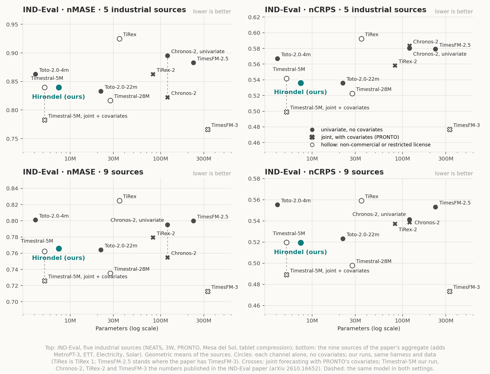

<p align="center"></p>

# Hirondel

*Hirondel — from French* hirondelle *(swallow), the bird said to tell the weather.*

Hirondel is a 7M-parameter time-series forecasting model for zero-shot probabilistic forecasting: 9 quantiles from 0.1
to 0.9 (tails to 0.01 and 0.99 by extrapolation), any horizon, CPU-friendly, **Apache-2.0** code and weights.

**One of the most accurate small time-series foundation models.** At release (October 2026), it was the most accurate on GIFT-Eval, fev-bench and TIME among models under 10M parameters with public weights and a permissive license (official leaderboards, read on 2026-10-23; how this was checked: `showcase/README.md`).

## Results

Headline numbers of this package (float32), computed with each benchmark's official harness
(`benchmarks/`, per-task details in `benchmarks/results/`):

<!-- results:start -->
| Benchmark | MASE | CRPS (fev-bench: SQL) |
|---|---|---|
| GIFT-Eval (97 tasks, normalised by Seasonal Naive; lower is better) | 0.7003 | 0.4816 |
| fev-bench (100 tasks, skill score in %; higher is better) | 32.91 | 44.90 |
| TIME (98 tasks, normalised by Seasonal Naive; lower is better) | 0.6551 | 0.5520 |
<!-- results:end -->

These numbers are computed by us and not yet listed on the leaderboards. Added to the fev-bench leaderboard, they would rank 7 of 33 (SQL) and 6 of 33 (MASE) among the models the site shows by default (2026-10-23).

### Univariate setting: every model forecasts each series alone

This model forecasts each series on its own, without covariates. Here every model is compared in that same setting:
we ran Chronos-2, Toto-2.0 (4m and 22m), TiRex and Timestral in forced univariate mode with their public packages;
TiRex, TimesFM-2.5, FlowState-r1.1 and Moirai-2.0 forecast each series alone by design (official results used where we
did not run them). The first list and its settings were written before any score; the models added later, to match the
official figure, are dated amendments with the source of each decision (`benchmarks/competitors.yaml`). t0-gamma and
TimesFM-3 use covariates and were not run in this setting; they appear in the official figure below.

<p align="center"></p>

| Model | Parameters | License | GIFT-Eval MASE | GIFT-Eval CRPS | TIME MASE | TIME CRPS | fev-bench SQL skill |
|---|---|---|---|---|---|---|---|
| Toto-2.0-4m | 4.1M | Apache-2.0 | 0.7591 | 0.5269 | 0.6940 | 0.5850 | 40.04 |
| Timestral-5M | 5.2M | Modified MIT (revenue cap) | 0.7102 | 0.4836 | 0.6571 | 0.5490 | 44.36 |
| **Hirondel (ours)** | 7.5M | Apache-2.0 | 0.7003 | 0.4816 | 0.6551 | 0.5520 | 44.90 |
| Moirai-2.0-small | 11.4M | CC-BY-NC-4.0 | 0.7281 | 0.5164 | 0.7030 | 0.5885 | 39.31 |
| FlowState-r1.1 | 18.5M | Apache-2.0 | 0.7014 | 0.4901 |  |  |  |
| Toto-2.0-22m | 21.9M | Apache-2.0 | 0.7226 | 0.5009 | 0.6751 | 0.5654 | 42.37 |
| Timestral-28M | 27.8M | Modified MIT (revenue cap) | 0.6817 | 0.4641 | 0.6455 | 0.5408 | 45.86 |
| TiRex | 35.0M | NX-AI Community License | 0.7213 | 0.4921 | 0.6831 | 0.5731 | 42.58 |
| Chronos-2 | 119.5M | Apache-2.0 | 0.7037 | 0.4911 | 0.6659 | 0.5584 | 43.97 |
| TimesFM-2.5 | 231.3M | Apache-2.0 | 0.7050 | 0.4903 | 0.6686 | 0.5674 | 42.20 |

Pareto fronts are drawn over models with a permissive license; models under a non-commercial or restricted license are
shown hollow. Every value, with its source, is in `showcase/data/univariate.csv`.

### Industrial data: IND-Eval

[IND-Eval](https://arxiv.org/abs/2610.16652) gathers forecasting tasks from industrial processes: offshore drilling
(NEATS), oil wells (3W), a multiphase flow facility (PRONTO), a solar and battery microgrid (Mesa del Sol) and tablet
compression. None of these five sources is in our training data, and they make the headline. The paper also averages
four sources that public benchmarks already use: MetroPT-3 (part of TIME), ETT, Electricity and Solar (part of
GIFT-Eval). We report them below the five, with the paper's mean over the nine. They say less about unseen data: the
paper's own audit finds Electricity and Solar documented in the pretraining data of Chronos-2 and TiRex-2.

Who computed what:
- **Hirondel**: our run, each sensor channel forecast alone, without covariates.
- **Timestral-5M**, the model closest in size: our run with the same harness, twice: as Hirondel, then forecasting the
  channels of a window jointly with PRONTO's control signals as known covariates (`benchmarks/competitors.py indeval
  --variant joint`).
- **Chronos-2, TiRex-2, TimesFM-3**: the numbers **published in the IND-Eval paper**, where they forecast the channels
  of a window jointly and read PRONTO's control signals as covariates.
- **Every model of our competitor list** (Timestral-5M and 28M, Chronos-2, TiRex, TimesFM-2.5, Toto-2.0-22m and 4m):
  our runs with the same harness, each channel alone as Hirondel, in the second table below.

<p align="center"></p>

nMASE / nCRPS (normalised by Seasonal Naive; lower is better), best of each metric in bold:

| Source | Hirondel (7.5M, ours) | Timestral-5M (5.2M) | Timestral-5M, joint + covariates (5.2M) | Chronos-2 (119M) | TiRex-2 (83M) | TimesFM-3 (331M) |
|---|---|---|---|---|---|---|
| NEATS (offshore drilling) | 0.937 / 0.496 | 0.903 / **0.484** | 0.900 / **0.484** | 0.915 / 0.516 | **0.899** / 0.551 | 0.924 / 0.494 |
| 3W (oil wells) | **0.754** / **0.653** | 0.768 / 0.685 | 0.762 / 0.681 | 0.847 / 0.749 | 0.837 / 0.786 | 0.756 / 0.690 |
| PRONTO (multiphase flow) | 0.956 / 0.853 | 0.968 / 0.888 | 0.696 / 0.591 | 0.754 / 0.569 | 0.957 / 0.719 | **0.617** / **0.473** |
| Mesa del Sol (solar and battery microgrid) | **0.838** / 0.493 | 0.853 / 0.491 | 0.846 / 0.492 | 0.864 / 0.948 | 0.901 / 0.542 | 0.841 / **0.481** |
| Tablet compression (pharmaceutical) | 0.737 / 0.325 | 0.730 / 0.323 | **0.727** / 0.323 | 0.744 / 0.324 | 0.736 / 0.321 | 0.729 / **0.318** |
| **Geometric mean, 5 industrial sources** | 0.839 / 0.536 | 0.840 / 0.542 | 0.783 / 0.499 | 0.822 / 0.583 | 0.863 / 0.558 | **0.766** / **0.477** |
| MetroPT-3 (metro compressor; in TIME) | 0.414 / 0.327 | 0.388 / 0.311 | 0.358 / **0.274** | 0.409 / 0.322 | 0.394 / 0.322 | **0.354** / 0.277 |
| ETT (electricity transformers; in GIFT-Eval) | 0.847 / 0.666 | 0.846 / 0.660 | 0.840 / 0.656 | 0.853 / 0.674 | 0.856 / 0.692 | **0.836** / **0.649** |
| Electricity (370 meters; in GIFT-Eval) | 0.715 / 0.576 | 0.722 / 0.582 | 0.722 / 0.582 | **0.680** / **0.545** | 0.723 / 0.590 | 0.699 / 0.558 |
| Solar (137 PV plants; in GIFT-Eval) | **0.864** / 0.495 | 0.878 / 0.494 | 0.878 / 0.494 | 0.891 / **0.478** | 0.911 / 0.523 | 0.869 / 0.482 |
| **Geometric mean, 9 sources (the paper's aggregate)** | 0.766 / 0.519 | 0.762 / 0.520 | 0.726 / 0.489 | 0.755 / 0.539 | 0.779 / 0.537 | **0.713** / **0.473** |

On PRONTO, a process driven by control signals, the models that read these signals as covariates are far ahead:
Timestral-5M goes from 0.968 / 0.888 without them to 0.696 / 0.591 with them. Hirondel, being univariate, cannot
anticipate the changes they cause. On the four other industrial sources, the geometric means are close: Hirondel
0.813 / 0.477, TimesFM-3 0.809 / 0.478, Timestral-5M 0.811 / 0.479 (joint, with covariates: 0.806 / 0.478), Chronos-2
0.840 / 0.587, TiRex-2 0.840 / 0.524. On each of these four sources Hirondel is within 5 % of the best model or ahead of
it, with 11 to 44 times fewer parameters than Chronos-2, TiRex-2 and TimesFM-3.

#### Every model in the univariate setting

The table above compares settings that differ: in the paper, Chronos-2, TiRex-2 and TimesFM-3 forecast the channels of
a window jointly and read PRONTO's covariates. Below, every model of our competitor list (`benchmarks/competitors.yaml`,
fixed before any score) forecasts each channel alone, with the same harness and the same data as Hirondel
(`benchmarks/competitors.py indeval`). In this setting, on the five industrial sources, Hirondel is ahead of Chronos-2,
TimesFM-2.5 and TiRex, level with Timestral-5M and Toto-2.0-22m, and behind Timestral-28M. Chronos-2, the one model in
both tables, goes from 0.822 / 0.583 forecasting jointly with covariates (the paper) to 0.895 / 0.580 alone (our run).

Two of these models are not the paper's versions: TiRex here is TiRex 1 (`NX-AI/TiRex`, 35M; the paper has TiRex-2), and
TimesFM-2.5 stands where the paper has TimesFM-3. They are the versions of our list, fixed before any score.

nMASE / nCRPS, geometric means (lower is better), best of each metric in bold:

| Model | Parameters | License | 5 industrial sources | 9 sources (the paper's aggregate) |
|---|---|---|---|---|
| Toto-2.0-4m | 4.1M | Apache-2.0 | 0.863 / 0.567 | 0.801 / 0.555 |
| Timestral-5M | 5.2M | Modified MIT (revenue cap) | 0.840 / 0.542 | 0.762 / 0.520 |
| **Hirondel (ours)** | 7.5M | Apache-2.0 | 0.839 / 0.536 | 0.766 / 0.519 |
| Toto-2.0-22m | 22M | Apache-2.0 | 0.833 / 0.536 | 0.764 / 0.523 |
| Timestral-28M | 28M | Modified MIT (revenue cap) | **0.817** / **0.523** | **0.735** / **0.498** |
| TiRex | 35M | NX-AI Community License | 0.925 / 0.593 | 0.825 / 0.559 |
| Chronos-2 | 119M | Apache-2.0 | 0.895 / 0.580 | 0.795 / 0.541 |
| TimesFM-2.5 | 231M | Apache-2.0 | 0.883 / 0.579 | 0.800 / 0.553 |

<details><summary>Per source, every model in the univariate setting</summary>

| Source | Toto-2.0-4m (4.1M) | Timestral-5M (5.2M) | Hirondel (7.5M, ours) | Toto-2.0-22m (22M) | Timestral-28M (28M) | TiRex (35M) | Chronos-2, univariate (119M) | TimesFM-2.5 (231M) |
|---|---|---|---|---|---|---|---|---|
| NEATS (offshore drilling) | 0.904 / 0.502 | 0.903 / 0.484 | 0.937 / 0.496 | 0.905 / 0.494 | **0.897** / **0.481** | 0.982 / 0.536 | 0.929 / 0.516 | 0.939 / 0.528 |
| 3W (oil wells) | 0.814 / 0.733 | 0.768 / 0.685 | **0.754** / 0.653 | 0.783 / 0.688 | **0.754** / **0.640** | 0.855 / 0.747 | 0.961 / 0.818 | 0.887 / 0.813 |
| PRONTO (multiphase flow) | 1.018 / 0.960 | 0.968 / 0.888 | 0.956 / 0.853 | **0.902** / **0.819** | 0.907 / 0.838 | 1.071 / 0.958 | 1.021 / 0.956 | 0.942 / 0.897 |
| Mesa del Sol (solar and battery microgrid) | 0.864 / 0.509 | 0.853 / 0.491 | 0.838 / 0.493 | 0.860 / 0.493 | **0.824** / **0.475** | 1.006 / 0.580 | 0.844 / 0.495 | 0.911 / 0.513 |
| Tablet compression (pharmaceutical) | 0.737 / 0.326 | 0.730 / 0.323 | 0.737 / 0.325 | 0.728 / 0.323 | **0.719** / **0.318** | 0.748 / 0.328 | 0.747 / 0.329 | 0.750 / 0.330 |
| **Geometric mean, 5 industrial sources** | 0.863 / 0.567 | 0.840 / 0.542 | 0.839 / 0.536 | 0.833 / 0.536 | **0.817** / **0.523** | 0.925 / 0.593 | 0.895 / 0.580 | 0.883 / 0.579 |
| MetroPT-3 (metro compressor; in TIME) | 0.441 / 0.351 | 0.388 / 0.311 | 0.414 / 0.327 | 0.388 / 0.318 | **0.349** / **0.279** | 0.508 / 0.395 | 0.428 / 0.341 | 0.437 / 0.356 |
| ETT (electricity transformers; in GIFT-Eval) | 0.878 / 0.688 | 0.846 / 0.660 | 0.847 / 0.666 | 0.855 / 0.674 | **0.833** / **0.657** | 0.867 / 0.684 | 0.850 / 0.667 | 0.862 / 0.678 |
| Electricity (370 meters; in GIFT-Eval) | 0.797 / 0.657 | 0.722 / 0.582 | 0.715 / 0.576 | 0.756 / 0.619 | 0.703 / 0.561 | 0.703 / 0.562 | **0.681** / **0.546** | 0.721 / 0.578 |
| Solar (137 PV plants; in GIFT-Eval) | 0.919 / 0.539 | 0.878 / 0.494 | 0.864 / 0.495 | 0.883 / 0.501 | 0.844 / **0.470** | **0.842** / 0.481 | 0.891 / 0.487 | 0.921 / 0.532 |
| **Geometric mean, 9 sources (the paper's aggregate)** | 0.801 / 0.555 | 0.762 / 0.520 | 0.766 / 0.519 | 0.764 / 0.523 | **0.735** / **0.498** | 0.825 / 0.559 | 0.795 / 0.541 | 0.800 / 0.553 |

</details>

Hirondel's numbers and those of the models we ran are our runs of `benchmarks/indeval.py` on the published data
(`benchmarks/results/indeval/`, `benchmarks/results/indeval_competitors/`). Our Seasonal Naive normalisation matches the
paper's to a few thousandths on the industrial sources and to about 1 % on the four others, not bit for bit. Windows
whose context is constant (a fifth of Mesa del Sol's) have no MASE scale: they are left out of the MASE of every model
and of Seasonal Naive, and kept in the CRPS. ETT is not distributed (CC BY-ND): its tasks are rebuilt locally with the
dataset's own script. IND-Eval has no leaderboard.

### Official leaderboards

The official leaderboards mix settings: some models use covariates (fev-bench) or forecast the variables of a series
jointly. Official results of well-known models, read on 2026-10-23, against their size (sources:
`showcase/data/official.csv`):

<p align="center"></p>

## Install

Python 3.10 or newer, PyTorch 2.4 or newer:

```bash
pip install "hirondel @ git+https://github.com/tncrd/hirondel@v1.0.0"           # core: torch, numpy, safetensors, huggingface_hub
pip install "hirondel[pandas] @ git+https://github.com/tncrd/hirondel@v1.0.0"   # adds forecast_df for pandas DataFrames
```

\* `pip install hirondel`: the PyPI release is in preparation; until then, install from GitHub as above.
From a clone of this repository: `pip install .` (or `pip install ".[pandas]"`).

## Quick start

```python
import numpy as np
from hirondel import HirondelForecaster

forecaster = HirondelForecaster.from_pretrained("Tncrd/Hirondel-7M")  # or a local folder holding config.json and model.safetensors

t = np.arange(1000)
context = np.sin(2 * np.pi * t / 24) + 0.1 * np.random.default_rng(0).normal(size=t.size)

forecast = forecaster.forecast(context, prediction_length=48)
print(forecast.quantiles.shape)       # (1, 48, 9): series, steps, quantile levels 0.1 ... 0.9
print(forecast.median[0, :4])         # point forecast
print(forecast.quantile(0.9)[0, :4])  # upper 90% quantile
```

`forecast()` takes one series (1-D array), a batch of equal-length series (2-D array) or a list of series of any
lengths; NaN values are treated as missing. By default (`flip=True`) each forecast averages the model run on the series
and on its negation; `flip=False` runs one pass instead of two. Also by default (`clip_nonnegative=True`, a flag of
`config.json`), when every observed value of a series is >= 0, its quantiles are clamped at 0 after the flip average;
series with a negative value are left as they are. `clip_nonnegative=False` turns it off. `forecast_df()` does the same
for a long pandas DataFrame (`item_id`, `timestamp`, `target`) and returns one row per future timestamp.

### Tail levels 0.01, 0.05, 0.95, 0.99

`forecast.quantile(q)` also accepts 0.01, 0.05, 0.95 and 0.99 (and `forecast_df(..., tail_quantiles=True)` adds their
columns). **These levels are extrapolated, not learned**: the network predicts the 9 levels 0.1 ... 0.9; each tail is
then extended by an exponential fitted on its two outermost levels (the `ExponentialTailApproximation` of GluonTS),
after the flip average (and floored at 0 for the series clipped at 0). No extra weights; the 9 predicted levels are
unchanged.

Measured coverage P(y ≤ q), this model with `flip=True`, before zero clipping was added (clipping only raises lower-tail
values of non-negative series, so their lower coverage can only go up):

| data | 0.01 | 0.05 | 0.95 | 0.99 |
|---|---|---|---|---|
| fresh 2026 series (424 windows, H = 96) | 0.009 | 0.046 | 0.950 | 0.985 |
| GIFT-Eval, test windows (H 48-900) | 0.007 | 0.039 | 0.947 | 0.984 |
| TIME (98 tasks) | 0.009 | 0.046 | 0.947 | 0.988 |
| fev-bench (100 tasks) | 0.012 | 0.044 | 0.938 | 0.979 |

Source: our measurement on the released weights, averaged over windows (fresh series, GIFT-Eval) or over tasks (TIME,
fev-bench). The upper tail runs slightly short, most on fev-bench (spiky and intermittent series).

## Hardware

Tested on CPU (Linux, PyTorch 2.12.1 and 2.4.1) and on an AMD GPU with ROCm 7.2 (RX 7900 XTX, PyTorch 2.12.1,
`device="cuda"`). CUDA GPUs are expected to work the same way but have not been tested.

## Numerical parity

`tests/test_parity.py` checks `forecast()` against outputs of the reference implementation on fixed
inputs (CPU, float32, one thread). With torch 2.12.1 every case matches bit for bit and the test is
strict (1e-6). With other torch versions small rounding differences remain; measured with torch
2.4.1 (the oldest supported version), the largest gap over all cases is 1.5e-5 standard deviations
of the input series; on the ROCm GPU above (float32), 2.7e-5.

## Limitations

- Univariate: each series is forecast on its own; covariates and cross-series information are not used. Models that use
  them (for example Chronos-2 on GIFT-Eval, Timestral with covariates on fev-bench) can do better on such tasks.
- Context: the last 2 048 points at full resolution, plus a coarse reading of up to 8 192 points. Very long seasonal
  histories are read coarsely.
- Tail levels 0.01, 0.05, 0.95, 0.99 are extrapolated, not learned; the upper tail runs slightly short.
- Tested on CPU and on one AMD GPU (ROCm); not yet on CUDA.

## Reproducing the numbers

`benchmarks/README.md` gives the commands for GIFT-Eval, fev-bench, TIME and the competitors, and `showcase/README.md`
how this page and its figures are regenerated (`python -m showcase.build`).

## License and data

Code and weights: Apache-2.0 (`LICENSE`). The training data and the attribution each source requires are listed in
`DATA.md`; `NOTICE` must be kept when redistributing.

## Citation

```bibtex
@misc{hirondel2026,
  title        = {Hirondel-7M: zero-shot probabilistic time-series forecasting},
  author       = {{The Hirondel Author (Tncrd)}},
  year         = {2026},
  howpublished = {\url{https://huggingface.co/Tncrd/Hirondel-7M}}
}
```

The same reference is in `CITATION.cff`.

## Contributing

See `CONTRIBUTING.md`.
