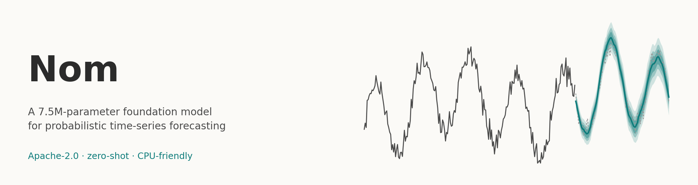
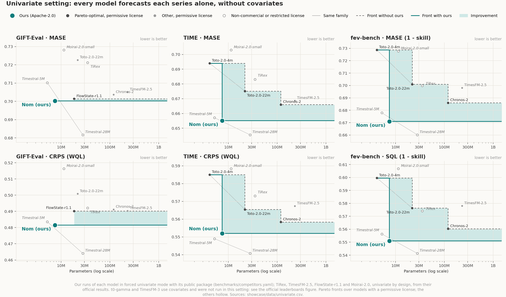
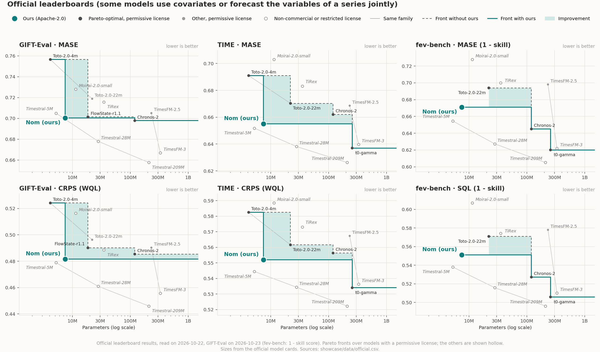

<p align="center"></p>

# Nom

A small foundation model for zero-shot probabilistic time-series forecasting: **7.5M parameters**, 9 quantiles from 0.1
to 0.9 (tails to 0.01 and 0.99 by extrapolation), any horizon, CPU-friendly, **Apache-2.0** code and weights.

**The most accurate forecasting model under 10M parameters with public weights and a permissive license, on GIFT-Eval, fev-bench and TIME** (official leaderboards, read on 2026-10-22; how this was checked: `showcase/README.md`).

## Results

Headline numbers of this package (float32), computed with each benchmark's official harness
(`benchmarks/`, per-task details in `benchmarks/results/`):

<!-- results:start -->
| Benchmark | MASE | CRPS (fev-bench: SQL) |
|---|---|---|
| GIFT-Eval (97 tasks, normalised by Seasonal Naive; lower is better) | 0.7003 | 0.4816 |
| fev-bench (100 tasks, skill score in %; higher is better) | 32.91 | 44.90 |
| TIME (98 tasks, normalised by Seasonal Naive; lower is better) | 0.6551 | 0.5520 |
<!-- results:end -->

On the fev-bench leaderboard this ranks 7 of 33 (SQL) and 6 of 33 (MASE) among the models the site shows by default (2026-10-22).

### Univariate setting: every model forecasts each series alone

This model forecasts each series on its own, without covariates. Here every model is compared in that same setting:
we ran Chronos-2, Toto-2.0 (4m and 22m), TiRex and Timestral in forced univariate mode with their public packages;
TiRex, TimesFM-2.5, FlowState-r1.1 and Moirai-2.0 forecast each series alone by design (official results used where we
did not run them). The first list and its settings were written before any score; the models added later, to match the
official figure, are dated amendments with the source of each decision (`benchmarks/competitors.yaml`). t0-gamma and
TimesFM-3 use covariates and were not run in this setting; they appear in the official figure below.

<p align="center"></p>

| Model | Parameters | License | GIFT-Eval MASE | GIFT-Eval CRPS | TIME MASE | TIME CRPS | fev-bench SQL skill |
|---|---|---|---|---|---|---|---|
| Toto-2.0-4m | 4.1M | Apache-2.0 |  |  | 0.6940 | 0.5850 | 40.04 |
| Timestral-5M | 5.2M | Modified MIT (revenue cap) | 0.7102 | 0.4836 | 0.6571 | 0.5490 | 44.36 |
| **Nom (ours)** | 7.5M | Apache-2.0 | 0.7003 | 0.4816 | 0.6551 | 0.5520 | 44.90 |
| Moirai-2.0-small | 11.4M | CC-BY-NC-4.0 | 0.7281 | 0.5164 | 0.7030 | 0.5885 | 39.31 |
| FlowState-r1.1 | 18.5M | Apache-2.0 | 0.7014 | 0.4901 |  |  |  |
| Toto-2.0-22m | 21.9M | Apache-2.0 | 0.7226 | 0.5009 | 0.6751 | 0.5654 | 42.37 |
| Timestral-28M | 27.8M | Modified MIT (revenue cap) | 0.6817 | 0.4641 | 0.6455 | 0.5408 | 45.86 |
| TiRex | 35.0M | NX-AI Community License | 0.7213 | 0.4921 | 0.6831 | 0.5731 | 42.58 |
| Chronos-2 | 119.5M | Apache-2.0 | 0.7037 | 0.4911 | 0.6659 | 0.5584 | 43.97 |
| TimesFM-2.5 | 231.3M | Apache-2.0 | 0.7050 | 0.4903 | 0.6686 | 0.5674 | 42.20 |

Pareto fronts are drawn over models with a permissive license; models under a non-commercial or restricted license are
shown hollow. Every value, with its source, is in `showcase/data/univariate.csv`.

### Official leaderboards

The official leaderboards mix settings: some models use covariates (fev-bench) or forecast the variables of a series
jointly. Official results of well-known models, read on 2026-10-22 (GIFT-Eval on 2026-10-23), against their size (sources:
`showcase/data/official.csv`):

<p align="center"></p>

## Install

From a clone of this repository (Python 3.10 or newer, PyTorch 2.4 or newer):

```bash
pip install .            # core: torch, numpy, safetensors, huggingface_hub
pip install ".[pandas]"  # adds forecast_df for pandas DataFrames
```

## Quick start

```python
import numpy as np
from nom import NomForecaster

forecaster = NomForecaster.from_pretrained("account/Nom-7M")  # or a local folder holding config.json and model.safetensors

t = np.arange(1000)
context = np.sin(2 * np.pi * t / 24) + 0.1 * np.random.default_rng(0).normal(size=t.size)

forecast = forecaster.forecast(context, prediction_length=48)
print(forecast.quantiles.shape)       # (1, 48, 9): series, steps, quantile levels 0.1 ... 0.9
print(forecast.median[0, :4])         # point forecast
print(forecast.quantile(0.9)[0, :4])  # upper 90% quantile
```

`forecast()` takes one series (1-D array), a batch of equal-length series (2-D array) or a list of series of any
lengths; NaN values are treated as missing. By default (`flip=True`) each forecast averages the model run on the series
and on its negation; `flip=False` runs one pass instead of two. Also by default (`clip_nonnegative=True`, a flag of
`config.json`), when every observed value of a series is >= 0, its quantiles are clamped at 0 after the flip average;
series with a negative value are left as they are. `clip_nonnegative=False` turns it off. `forecast_df()` does the same
for a long pandas DataFrame (`item_id`, `timestamp`, `target`) and returns one row per future timestamp.

### Tail levels 0.01, 0.05, 0.95, 0.99

`forecast.quantile(q)` also accepts 0.01, 0.05, 0.95 and 0.99 (and `forecast_df(..., tail_quantiles=True)` adds their
columns). **These levels are extrapolated, not learned**: the network predicts the 9 levels 0.1 ... 0.9; each tail is
then extended by an exponential fitted on its two outermost levels (the `ExponentialTailApproximation` of GluonTS),
after the flip average (and floored at 0 for the series clipped at 0). No extra weights; the 9 predicted levels are
unchanged.

Measured coverage P(y ≤ q), this model with `flip=True`, before zero clipping was added (clipping only raises lower-tail
values of non-negative series, so their lower coverage can only go up):

| data | 0.01 | 0.05 | 0.95 | 0.99 |
|---|---|---|---|---|
| fresh 2026 series (424 windows, H = 96) | 0.009 | 0.046 | 0.950 | 0.985 |
| GIFT-Eval, test windows (H 48-900) | 0.007 | 0.039 | 0.947 | 0.984 |
| TIME (98 tasks) | 0.009 | 0.046 | 0.947 | 0.988 |
| fev-bench (100 tasks) | 0.012 | 0.044 | 0.938 | 0.979 |

Source: our measurement on the released weights, averaged over windows (fresh series, GIFT-Eval) or over tasks (TIME,
fev-bench). The upper tail runs slightly short, most on fev-bench (spiky and intermittent series).

## Hardware

Tested on CPU (Linux, PyTorch 2.12.1 and 2.4.1) and on an AMD GPU with ROCm 7.2 (RX 7900 XTX, PyTorch 2.12.1,
`device="cuda"`). CUDA GPUs are expected to work the same way but have not been tested.

## Numerical parity

`tests/test_parity.py` checks `forecast()` against outputs of the reference implementation on fixed
inputs (CPU, float32, one thread). With torch 2.12.1 every case matches bit for bit and the test is
strict (1e-6). With other torch versions small rounding differences remain; measured with torch
2.4.1 (the oldest supported version), the largest gap over all cases is 1.5e-5 standard deviations
of the input series; on the ROCm GPU above (float32), 2.7e-5.

## Limitations

- Univariate: each series is forecast on its own; covariates and cross-series information are not used. Models that use
  them (for example Chronos-2 on GIFT-Eval, Timestral with covariates on fev-bench) can do better on such tasks.
- Context: the last 2 048 points at full resolution, plus a coarse reading of up to 8 192 points. Very long seasonal
  histories are read coarsely.
- Tail levels 0.01, 0.05, 0.95, 0.99 are extrapolated, not learned; the upper tail runs slightly short.
- Tested on CPU and on one AMD GPU (ROCm); not yet on CUDA.

## Reproducing the numbers

`benchmarks/README.md` gives the commands for GIFT-Eval, fev-bench, TIME and the competitors, and `showcase/README.md`
how this page and its figures are regenerated (`python -m showcase.build`).

## License and data

Code and weights: Apache-2.0 (`LICENSE`). The training data and the attribution each source requires are listed in
`DATA.md`; `NOTICE` must be kept when redistributing.

## Citation

See `CITATION.cff`.

## Contributing

See `CONTRIBUTING.md`.
